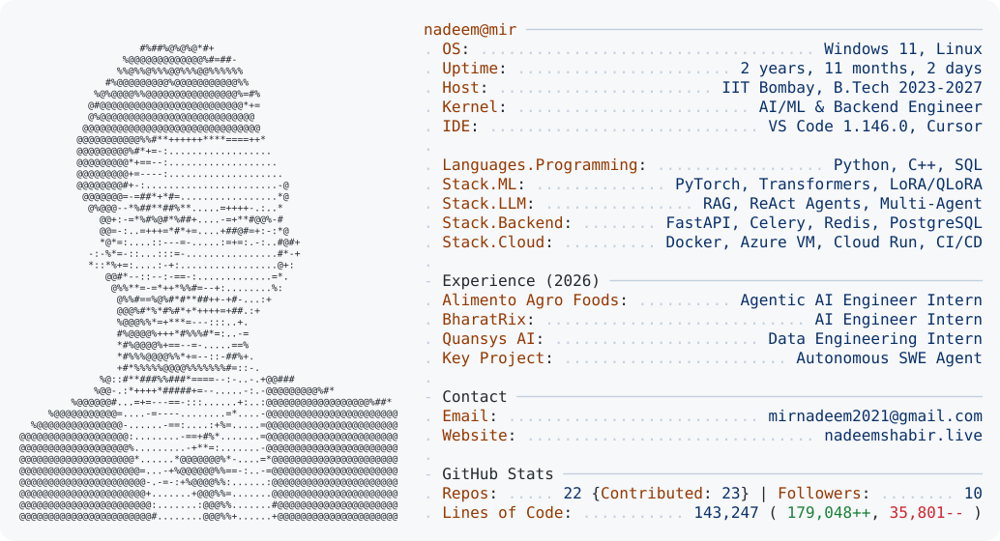

<!--
  How this card works:
  - profile.json holds every line of text on the card. Edit it and push.
  - art/dark.txt and art/light.txt hold the ASCII portrait for each theme.
  - scripts/build_card.py turns them into dark_mode.svg and light_mode.svg
    and fills in live GitHub stats.
  - .github/workflows/refresh.yml rebuilds the card every day (00:05 IST)
    and after every push, so Uptime and the stats stay current.
-->
<picture>
  <source media="(prefers-color-scheme: dark)" srcset="dark_mode.svg">
  <source media="(prefers-color-scheme: light)" srcset="light_mode.svg">
  
</picture>

  <a href="https://www.nadeemshabir.live/">Website</a> ·
  <a href="mailto:mirnadeem2021@gmail.com">Email</a> ·
  <a href="https://github.com/nadeemshabir/auto-swe-agent">Autonomous SWE Agent</a>

